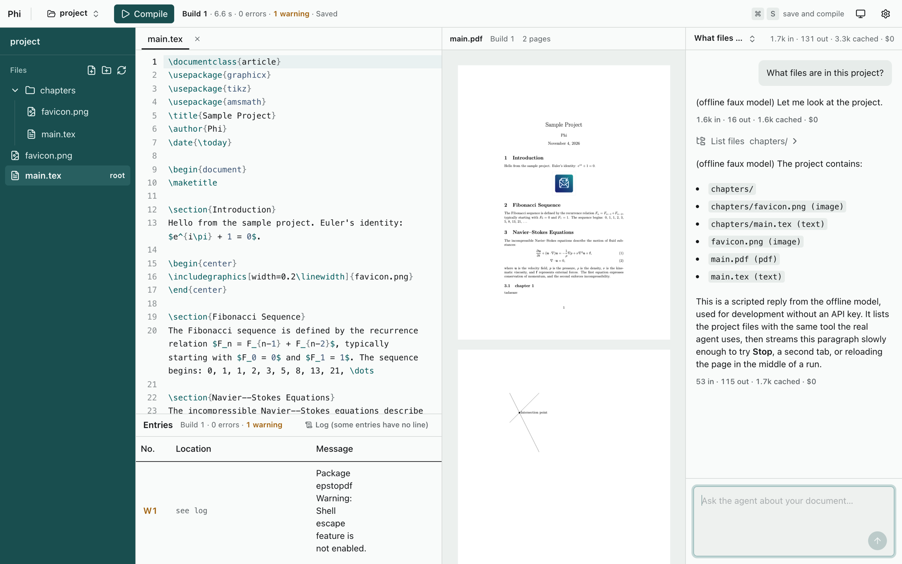

# Phi

A LaTeX editor that runs on your own machine, in your browser, with an AI agent built in. Edit,
compile and read the PDF in one window, like Overleaf, but your files stay in an ordinary folder
on disk. The agent reads your project, compiles it and fixes errors, and every edit it proposes
is shown inline for you to accept or reject before anything changes.



## Features

- **Editor:** CodeMirror with LaTeX highlighting, completion (commands, environments, `\ref`
  labels, `\cite` keys, file paths) and `\begin`/`\end` pairs that close and rename together.
- **Compile:** latexmk, with every error and warning numbered (E1, W1) and linked to its line.
  Autosave, and Cmd/Ctrl+S to save and compile.
- **PDF:** built-in viewer that keeps its place across rebuilds; SyncTeX jumps between source and
  PDF in both directions.
- **Agent:** lists, reads and searches your files, compiles, and proposes edits as inline diffs
  you review hunk by hunk. File creation, renames and deletions also wait for your approval.
- **Providers:** OpenRouter (including free models), Claude, OpenAI and Mistral, one key each,
  switchable in Settings.
- **Local:** projects are plain folders, so git and other editors keep working. Changes made on
  disk are detected, never silently overwritten.

## Requirements

- [Bun](https://bun.sh) 1.4.3 or newer.
- A TeX distribution with `latexmk`:
  - macOS: [MacTeX](https://tug.org/mactex/), or BasicTeX plus `sudo tlmgr install latexmk`.
  - Linux: TeX Live, e.g. `sudo apt install latexmk texlive-latex-extra`.
  - Windows: MiKTeX or TeX Live (untested).
- Optional: [texlab](https://github.com/latex-lsp/texlab) (`brew install texlab`) for completion
  across the whole project. Without it, Phi falls back to a basic built-in list.
- An API key for one model provider, e.g. a free [OpenRouter](https://openrouter.ai/keys) key.

## Quick start

```sh
git clone <this repo> phi && cd phi
bun install
bun link             # makes the `phi` command available everywhere
phi init my-paper    # pick a template with the arrow keys; the browser opens on it
```

Then open Settings (the gear icon), pick a provider and paste its key.

- `phi init [path]` creates a project from a template: blank, beamer presentation, scientific
  paper or thesis. It never overwrites existing files. `--template <id>` skips the menu.
- `phi open [path]` opens an existing project folder.
- `--no-open` doesn't open the browser.

Phi serves on http://127.0.0.1:3000 (or the next free port) until Ctrl+C. If Phi is already
running, `phi` switches it to the project instead of starting a second server.

## Configuration

Everything can be set in the app. Environment variables (in a `.env` file at the repo root, see
[.env.example](.env.example)) override it:

| Variable                                                                       | Meaning                                                                                                                   |
| ------------------------------------------------------------------------------ | ------------------------------------------------------------------------------------------------------------------------- |
| `PORT`                                                                         | Server port (default 3000).                                                                                               |
| `PROJECT_ROOT`                                                                 | Project opened at startup (default: the most recent one).                                                                 |
| `LLM_PROVIDER`                                                                 | Pins the provider: `openrouter`, `anthropic`, `openai` or `mistral`. `faux` is an offline scripted model for development. |
| `LLM_MODEL`                                                                    | Pins that provider's model, e.g. `openrouter/free`, `claude-sonnet-5-5`.                                                  |
| `OPENROUTER_API_KEY`, `ANTHROPIC_API_KEY`, `OPENAI_API_KEY`, `MISTRAL_API_KEY` | Provider keys; override keys saved in Settings.                                                                           |

Deployment settings (see [Deploy to Google Cloud](#deploy-to-google-cloud)): `HOST`,
`PUBLIC_ORIGIN`, `PROJECTS_DIR`, `IAP_AUDIENCE`, `ALLOWED_EMAIL`, `NODE_ENV=production`, and
`ALLOW_NO_AUTH=1` for a container published only on 127.0.0.1.

## Where your data lives

- **Project files:** your project folder, untouched apart from the edits you make or accept.
- **Conversations, trash and project settings:** `<project>/.latex-agent/`, hidden from the file
  tree and the agent. Add it to your `.gitignore` if you use git.
- **Provider keys, model choices and recent projects:** `~/.latex-agent/settings.json`, readable
  by your user only. Keys never reach the browser; Settings shows only their last 4 characters.

Model requests go straight from your machine to the provider you chose. Nothing else leaves it.

## Security

Phi is a single-user tool for your own machine:

- The server listens on 127.0.0.1 only. Requests from other web pages (foreign `Origin`) and
  DNS-rebinding attempts (foreign `Host`) are refused.
- Every file path is confined to the open project. Paths that escape it, including through
  symlinks, are refused.
- latexmk always runs with `-no-shell-escape` and without project `latexmkrc` files. The agent
  has no shell tool.

Don't expose the port to a network; to reach Phi from elsewhere, deploy it behind IAP as below.
See [SECURITY.md](SECURITY.md) to report a vulnerability.

## Deploy to Google Cloud

Phi can also run as your personal instance on Google Cloud, reachable from any browser after a
Google sign-in that only your account passes: one VM running the Phi container, your projects
on a persistent disk with daily snapshots, an HTTPS load balancer with Identity-Aware Proxy
(IAP) in front. Roughly $45–50 a month.

```sh
cp deploy/gcp/phi.conf.example deploy/gcp/phi.conf   # project, domain, your email…
deploy/gcp/setup.sh                                   # once: VM, disk, load balancer, IAP
deploy/gcp/deploy.sh                                  # build the image and start it
```

The full guide, with the prerequisites (a domain and an OAuth client), updates, rollback,
backups and costs, is in [deploy/gcp/README.md](deploy/gcp/README.md).

Deployed, projects live in one folder on the server: you create them from a template in the
browser, and **Download as .zip** in the project menu gets one back. Every API request must
carry IAP's signed header for your account, checked by Phi itself.

To try the container on your machine first (Docker, about 2.3 GB with TeX Live):

```sh
docker build -t phi .
docker run --rm -p 127.0.0.1:3000:3000 -v "$PWD/.phi-data:/data" \
  -e ALLOW_NO_AUTH=1 -e PUBLIC_ORIGIN=http://localhost:3000 phi
```

`ALLOW_NO_AUTH=1` is only for this: without IAP, Phi has no login, so the port must stay on
127.0.0.1.

## Development

```sh
bun dev              # server with hot reload on http://127.0.0.1:3000
bun test             # all tests (TeX tests are skipped when latexmk or texlab is missing)
bun run typecheck
bun run format
```

The repo is a Bun workspace:

| Path              | What                                                                             |
| ----------------- | -------------------------------------------------------------------------------- |
| `apps/server`     | Bun.serve: the API, the agent (pi), compiling, the LaTeX language server bridge. |
| `apps/web`        | React 19, CodeMirror 6, pdf.js, zustand, shadcn/ui on Tailwind v4.               |
| `apps/cli`        | The `phi` command.                                                               |
| `packages/shared` | Types and edit matching shared by server and web.                                |
| `templates/`      | Project templates for `phi init`.                                                |

Product behavior is specified in [SPEC.md](SPEC.md). See [CONTRIBUTING.md](CONTRIBUTING.md)
before opening a pull request.

## License

[MIT](LICENSE). Third-party material is listed in [THIRD_PARTY_NOTICES.md](THIRD_PARTY_NOTICES.md).
